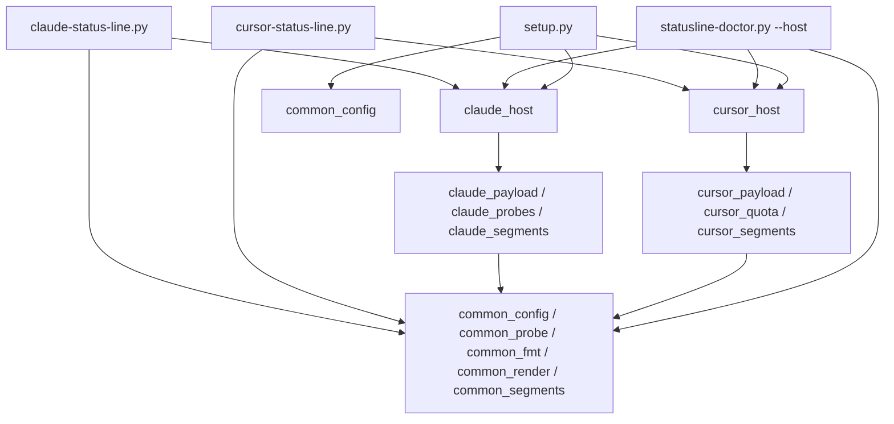

# Host-split status line (Claude Code + Cursor CLI) — design spec

- **Status:** design, reviewed with open findings; not planned, not
  implemented.
- **Open review findings:** `2026-10-10-host-split-statusline-design-REVIEW.md`
  (same directory). Its R3-* items MUST be resolved in discuss/plan-phase
  before execution; its owner decisions are final.
- **Backlog entry:** `.planning/ROADMAP.md` §Backlog, Phase 999.4.
- **Implementer:** a different agent, entering through `/gsd-discuss-phase`
  on Phase 999.4. This spec is the design input; it is not a plan.
- **Base branch:** `gsd/v1.3-curated-config-v2` (holds the latest
  `tools/status-line.py`). Work happens in a git worktree; the main
  checkout stays on `main`.

## 1. Goal

ai-kit's status line today serves Claude Code only. Cursor CLI
(`cursor-agent`) now supports a Claude-compatible `statusLine` hook, but its
payload and what matters to a Cursor user differ: Cursor bills against an
included monthly quota plus optional on-demand spend, not Claude's 5-hour /
weekly rate limits.

Deliver, in three ordered phases, each independently shippable:

- **Phase A — split.** Turn the single `tools/status-line.py` into reusable
  `common_*` modules plus host modules `claude_*`, with a thin
  `claude-status-line.py` entry. Zero change in rendered output for a Claude
  payload once the new entry is wired. The hard rename ships with no shim and
  no forwarding `status-line.py`, so an existing installation has an accepted
  upgrade gap until `setup.py` re-runs (§6.2, §9); the renames and their
  migrations ship together in this phase.
- **Phase B — Cursor host.** Add `cursor_*` modules and a
  `cursor-status-line.py` entry with Cursor-native segments: a compact
  model/context segment (including `model.param_summary`, the only
  effort-like field in Cursor's payload; see §5.2), included-quota usage,
  billing cycle, and on-demand status against its monthly ceiling.
- **Phase C — multi-host setup.** `tools/setup.py` and the wizard detect each
  supported host and run the existing verify / replace / keep flow per host.

Non-goal: making Claude-only behavior "just work" on Cursor. Anything whose
data or semantics differ by host lives in that host's module, never in
`common_*`.

## 2. Verified facts and their confidence

Live-checked on 2026-10-10 against `cursor-agent` 2026.10.01-e373342
(Pro tier). The implementer must re-verify in the Phase B spike (§6.1)
before relying on anything marked *inferred*.

| Fact | Source | Confidence |
|---|---|---|
| `statusLine` lives in `~/.cursor/cli-config.json`: `type: "command"`, `command`, optional `padding`, `updateIntervalMs` (>= 300, default 300), `timeoutMs` (default 2000). Multi-line ANSI stdout is supported; non-zero exit with empty stdout keeps the previous line. | Cursor's bundled `statusline` skill; `statusLine` present in the agent bundle `index.js` | documented |
| Payload fields: `session_id`, `session_name?`, `transcript_path`, `render_width_chars`, `cwd`, `autorun`, `model.{id, display_name, param_summary?, max_mode?}`, `workspace.{current_dir, project_dir, added_dirs}`, `version`, `output_style.name`, `context_window.{total_input_tokens, total_output_tokens, context_window_size, used_percentage, remaining_percentage, current_usage}`, `vim.mode?`, `worktree.{name, path}?`. No `cost`, no `rate_limits`, no `effort`. `model.param_summary` is the only effort-like field; whether it actually carries reasoning effort is unconfirmed until a real payload is captured. | Cursor's bundled `statusline` skill | documented, no real payload captured yet |
| Updates are debounced at `updateIntervalMs`; when a new update arrives while the command is still running, the in-flight process is killed (via `AbortController`) and the new invocation starts immediately. So a render can be cancelled after as little as the update interval (default 300 ms), well before `timeoutMs`. | Cursor's bundled `statusline` skill | documented |
| The current `status-line.py` renders a synthetic Cursor-shaped payload without crashing (path, model, context bar). | local run with temp `HOME`/`XDG_*` | verified |
| Cursor's own `/usage` command ("Show plan and on-demand usage", bundle module `src/usage/usage-data.ts`) calls `aiserver.v1.DashboardService` methods `GetCurrentPeriodUsage`, `GetHardLimit`, `GetPlanInfo` over Connect-RPC; default endpoint `https://api2.cursor.sh`. | agent bundle source | inferred (undocumented, private API) |
| `GetCurrentPeriodUsageResponse`: `billing_cycle_start`, `billing_cycle_end` (epoch ms); `plan_usage.{total_spend, included_spend, bonus_spend, remaining, limit, auto_percent_used?, api_percent_used?, total_percent_used?}`; `spend_limit_usage.{individual_used, individual_limit?, limit_type, ...}`. Cents (`/usage` divides by 100). | bundle proto descriptors | inferred |
| `GetHardLimitResponse.hard_limit` is in dollars; `>= 2147483647` means unlimited; `no_usage_based_allowed` means on-demand disabled. `GetPlanInfoResponse.plan_info.{plan_name, included_amount_cents, billing_cycle_end, included_usage_resets_at?}`. | bundle proto descriptors + `/usage` logic | inferred |
| `/usage` classifies on-demand as `fixed` (has a ceiling), `unlimited`, `disabled`, or `unavailable`; when `plan_usage` is absent it falls back to an enterprise spend view or reports "not available for this plan in the CLI". | `/usage` logic in the bundle | inferred |
| CLI auth is stored at `~/.config/cursor/auth.json` with keys `accessToken`, `refreshToken`. | file shape inspected (values not read) | verified shape; token lifetime unknown |

## 3. Current state (what exists, what it assumes)

- `tools/status-line.py` (2618 lines on the base branch) is banner-delimited
  into blocks DEFAULTS, `cfg_`, `probe_`, `fmt_`, `util_`, `core_`, `seg_`,
  SHELL, HOW-TO. `tests/test_arch.py` enforces the banner/role-prefix
  rules by AST over that one file and mirrors segments against
  `tools/segments_inventory.toml`.
- Claude-only pieces inside it: `cfg_resolve_effort`,
  `probe_effort_setting_is_auto` (reads `.claude/settings*.json`), the
  todo/transcript/compaction probes, `seg_effort`, `seg_todo`,
  `seg_chat_size`, `seg_lines`, `seg_alt_cost`, `seg_alt_time_*`,
  `seg_alt_h_rate_limit`, `seg_alt_w_rate_limit`, `seg_alt_process_memory`
  with `probe_rss_bytes` (it returns RSS only for an ancestor process named
  `claude`), and the `cost`,
  `rate_limits`, `claude_dir` fields on `Context`/`core_build_context`.
- Duplication caused by the hyphenated filename: `tools/setup.py` copies the
  SEGMENTS/LAYOUT defaults and `_SEG_HEADER_RE` ("duplicated here, not
  imported"); `tools/statusline-doctor.py` loads the module through
  `importlib.util.spec_from_file_location`.
- Setup flow (Claude only): `detect_statusline(paths)` classifies
  `settings.json` `statusLine` as `unset`/`ours`/`foreign`;
  `wire_statusline(...)` writes atomically via `_read_json_checked` +
  `_atomic_write_json`, refreshes silently when absent/ours, and requires an
  explicit yes for a foreign command (refuses headless). The wizard shows an
  adoption gate and one Arrange step. Headless: `--with-statusline`.
- Multi-host precedent: `--with-hooks` wires Claude and Cursor
  (`wire_hook_claude`, `wire_hook_cursor`), with Cursor presence decided by
  `os.path.isdir(paths.cursor_dir)`. Host-prefixed modules already exist in
  `tools/hooks/` (`claude_session_start.py`, `cursor_session_start.py`,
  host-agnostic `detect.py`), loaded via
  `sys.path.insert(0, os.path.dirname(os.path.realpath(__file__)))`.

## 4. Architecture

### 4.1 Module layout (flat, in `tools/`)

All runtime modules stay stdlib-only and must work under `python3 -S`.

| Module | Holds |
|---|---|
| `common_config.py` | host-neutral DEFAULTS data and `cfg_` functions (TOML load, env/TOML binding, layout/segment resolution, cache dir, external segments) |
| `common_probe.py` | host-neutral `probe_` functions (terminal size, git snapshot/worktree cache, generic proc/ps helpers: comm/ppid/RSS-by-pid) |
| `common_fmt.py` | `fmt_` and host-neutral `util_` functions (color, ramps, width, truncate, fit, `util_rate_gap` and friends) |
| `common_render.py` | `Context`, `Theme`, segment registry, packer, render, SHELL `main(host)` / `safe_render(host)` |
| `common_segments.py` | segments whose data is host-neutral (path, git_branch, git_dirty, alt_git_worktree, render_time, slowest, alt_term_dimensions, alt_time_clock, and any others the classification audit in §8 proves neutral) |
| `claude_payload.py` | Claude payload → `Context` (incl. `ctx.host` fields: cost, lines, durations, rate_limits, effort, claude_dir) |
| `claude_probes.py` | effort-setting probe, todo/tasks/transcript probes, transcript compaction, `probe_rss_bytes` (the `claude`-ancestor RSS lookup, built on `common_probe`'s generic proc helpers) |
| `claude_segments.py` | effort, model, context, todo, chat_size, lines, alt_cost, alt_time_*, alt_process_memory, rate-limit segments |
| `claude_host.py` | the single owner of Claude's `HOST` object (§4.2): imports `claude_payload`, `claude_probes`, `claude_segments` and the host's defaults, and assembles them |
| `claude-status-line.py` | thin entry for Claude Code |
| `cursor_payload.py` | Cursor payload → `Context` |
| `cursor_quota.py` | Dashboard fetch, auth read, cache, typed `QuotaResult` (§5.3) |
| `cursor_segments.py` | Cursor segments (§5.2) |
| `cursor_host.py` | the single owner of Cursor's `HOST` object (§4.2), assembled from `cursor_payload`, `cursor_quota`, `cursor_segments` and the host's defaults |
| `cursor-status-line.py` | thin entry for Cursor CLI |

`model`/`context` segments: if the audit shows the Claude and Cursor
renderings genuinely share one implementation, put it in `common_segments.py`;
otherwise each host owns its own. Do not force a shared segment to absorb a
host-specific variant via flags.

### 4.2 Host contract

Each host is described by one `HOST` object (a `NamedTuple` or frozen
dataclass in `common_render.py`'s type vocabulary), defined in exactly one
module per host: `claude_host.py` and `cursor_host.py` (§4.1). Every other
consumer obtains it by importing that module's `HOST`: the entries (§4.3),
`setup.py` and the wizard (per-host defaults, segment lists, config
filename), `statusline-doctor.py --host` (payload adapter, probes, segment
registry), and `common_render` (which receives it as an argument and never
imports a host module). The payload adapter, probes, and segment registry
are reached through `HOST` fields, not by importing `claude_payload` /
`cursor_payload` / `*_segments` directly:

- `name`: `"claude"` or `"cursor"`.
- `build_context(raw, config, theme, ...) -> Context`.
- `segment_funcs`: mapping `segment_id -> seg_*` callable for this host.
- `default_segments`, `default_layout`: the host's defaults.
- `config_filename`: `claude-statusline.toml` / `cursor-statusline.toml`.
- `env_prefix`: `CC_AI_KIT_` for Claude, `AI_KIT_CURSOR_` for Cursor. The
  existing `CC_AI_KIT_*` overrides (`CONFIG_FILE`, `SEGMENT_<KEY>`,
  `GIT_CACHE_TTL`, `EXTERNAL_DIR`, `EXTERNAL_CACHE_TTL`) keep applying to
  Claude only, unchanged (backward compatible). Cursor ignores every
  `CC_AI_KIT_*` variable and reads the same override names under its own
  prefix (for example `AI_KIT_CURSOR_CONFIG_FILE`), so one host's override
  can never route the other host to its TOML. `cfg_` resolution takes the
  prefix from `HOST` instead of hardcoding it.
- `external_cache_subdir`: the external-segment output cache directory under
  `cfg_cache_base()`; `segments` for Claude (unchanged, zero behavior
  change), `segments-cursor` for Cursor (§5.4).

`Context` keeps only host-neutral fields; host data lives in a typed
`ctx.host` object defined by each host module. Generic code never reads
`ctx.host`.

The registry merges `common_segments` and the host's `segment_funcs`; a
duplicate segment id is a startup error (and a `test_arch.py` failure),
never a silent override.

### 4.3 Entries

Each entry is a few lines: insert the realpath directory into `sys.path`
(the `tools/hooks/` precedent), import `common_render` and its host's
`HOST` from `claude_host` / `cursor_host`, call `common_render.safe_render(HOST)`. Hyphenated names keep the
`# pylint: disable=invalid-name` precedent.

### 4.4 Dependency direction (enforced)

- `common_*` never imports `claude_*` or `cursor_*`.
- `claude_*` and `cursor_*` never import each other.
- Only the entries, `setup.py`/wizard, and the doctor import `claude_host` /
  `cursor_host`; nothing else does.
- `setup.py` imports `common_config` (defaults, segment-header regex) instead
  of duplicating them, and imports the `*_host` modules for per-host
  defaults and config filenames; its own wizard-only dependencies are
  unchanged and the host modules stay stdlib-only.

### 4.5 Architecture tests

Extend `tests/test_arch.py` (never bypass it):

- Apply the banner and role-prefix rules per module (each `common_*`/host
  module carries the banner blocks for the roles it contains).
- Add the dependency-direction rules in §4.4, each with a
  `TestArchNonVacuity` counterpart that proves it catches a violation.
- Duplicate segment id across common and a host fails.
- `tools/segments_inventory.toml` gains a host dimension (which host(s) a
  segment belongs to); the existing coverage/line/icon mirror tests run per
  host.

## 5. Cursor host behavior

### 5.1 Payload mapping

- `model.display_name`, `model.id`, `model.param_summary`, `model.max_mode`.
- `context_window.used_percentage`, `context_window_size`; treat null as
  absent (render nothing, not 0%) early in the session.
- `workspace.current_dir` for path and git.
- `render_width_chars`: Cursor documents it as the usable columns after its
  built-in padding, so it is Cursor's width source. A valid value (a
  positive integer) wins; only when it is absent or invalid does
  `cursor_payload` fall back to the common terminal-size probe. Probed
  terminal width necessarily overestimates the space available when
  `padding` is configured.
- Ignored in the first cut: `autorun`, `vim`, `session_name`, `worktree`
  (the git probe already covers worktrees), `output_style`.

### 5.2 Segments

- **`cursor_model`** — compact `Model · <context size> · <param_summary>`
  plus the context percentage, in the style of Cursor's own footer. Max
  mode is shown as a short marker when `max_mode` is true. Exact glyphs
  and ordering are settled in discuss-phase with a rendered sample.
  "Effort" for Cursor means exactly `model.param_summary` shown verbatim
  (an opaque display string); the payload has no `effort` field. It is
  not Claude's settings-derived effort level (`seg_effort`), which is not
  offered for Cursor. If the spike's captured payload shows
  `param_summary` does not carry effort information, drop the "effort"
  wording from the goal and backlog entry rather than synthesizing it.
- **`cursor_included`** — included quota `total_percent_used` (fallback
  `included_spend / limit * 100`), colored with the existing pace-gap ramp:
  usage percentage versus elapsed fraction of the billing cycle
  (`billing_cycle_start` → `billing_cycle_end`). `util_rate_gap` is keyed on
  Claude window names today; generalize it to accept an explicit
  `(window_start, window_end)` instead of copying it. Optional auto/API split
  behind a toggle.
- **`cursor_cycle`** — billing-cycle reset date and days remaining. A toggle
  may fold it into `cursor_included`.
- **`cursor_on_demand`** — shows the on-demand state and spend:
  - `disabled`: dim "on-demand off".
  - `fixed`: `$used / $ceiling`; color ramp driven by `used / ceiling`
    (closer to the ceiling is hotter). This is NOT the pace ramp.
  - `unlimited`: `$used` with "no cap", no ramp.
  - `unavailable`: hidden (doctor explains).
  - Highlight state: included quota exhausted (`total_percent_used >= 100`)
    and on-demand `used > 0` — the user has started paying beyond the plan.
- Not offered for Cursor (no data): Claude-style effort-from-settings, todo, chat_size,
  lines, cost, session/API time, rate limits.
- **Confidence marker:** quota segments come from an undocumented API.
  They carry a visible marker (for example a dim `≈` suffix) and the doctor
  labels them "inferred — undocumented Cursor API", per `AGENTS.md`'s
  sourcing-confidence rule. Stale cached data is visibly marked as stale.

### 5.3 Quota data source (`cursor_quota.py`)

- Transport: stdlib `urllib.request`, Connect-RPC unary over HTTPS, JSON
  encoding, `POST {endpoint}/aiserver.v1.DashboardService/<Method>`, bearer
  auth. Exact headers and encoding are confirmed by the spike (§6.1).
  Endpoint honors `CURSOR_API_ENDPOINT` (the CLI's own override), default
  `https://api2.cursor.sh`.
- Calls: `GetCurrentPeriodUsage`, `GetHardLimit`, `GetPlanInfo`.
- Auth: read `accessToken` from the CLI's `auth.json` read-only. Never
  refresh, never write it, never log, print, cache, or pass it on argv. The
  auth file path resolution is confirmed in the spike.
- Budget: the binding limit is Cursor's cancellation of an in-flight
  command on the next update (§2), not `timeoutMs`; a render can be killed
  after as little as `updateIntervalMs` (default 300 ms). A render that
  blocks on the network may therefore never complete or write its cache.
  The network call has a hard timeout well under `timeoutMs`.
- Single-flight refresh (mandatory, not optional): at most one refresh is
  in flight per cache across successive renders and across concurrent
  Cursor sessions. A render that finds the cache stale (or absent) and
  no live lock takes an `O_EXCL` lock file next to the cache (holding
  the refresher's pid and start time) before it starts a fetch or
  spawns a detached refresher, and a render that finds a live lock
  serves cached/stale data and starts nothing. The lock is released by
  the refresher after its cache write; a lock older than the hard fetch
  timeout plus a margin is treated as dead and may be taken over, so a
  refresher killed before its cache write cannot block refreshes
  forever. A failed fetch writes the negative cache entry (below) before
  releasing the lock, so even failures do not re-trigger a refresh
  within the negative TTL.
- Cache: on-disk under `cfg_cache_base()` (e.g. `<cache>/cursor/usage.json`,
  mode 0600, atomic write via `mkstemp` + `os.replace`), storing only the
  derived numbers — never the token. Fresh TTL (default 120 s) and a
  negative cache for 401/403/network errors (default 600 s) so a broken
  auth does not hammer the API every 300 ms.
- Typed result (the contract between `cursor_quota` and its consumers):
  `cursor_quota` exposes one frozen `QuotaResult` (a `NamedTuple` or
  frozen dataclass), and every consumer reads only that type:
  - `state`: `ok` | `stale` | `auth_expired` | `network_error` |
    `plan_unavailable` | `absent` (no data and nothing cached).
  - values (present only for `ok`/`stale`): `billing_cycle_start`,
    `billing_cycle_end` (epoch ms), `total_percent_used`,
    `included_spend`, `limit`, optional auto/API percents, and the
    on-demand `kind` (`fixed` | `unlimited` | `disabled` | `unavailable`)
    with `used` and `ceiling` in dollars. Units are normalized once in
    `cursor_quota`; consumers never see cents or raw RPC shapes.
  - `fetched_at` (epoch s) for freshness; `stale` means older than the
    fresh TTL but still served.
  - `confidence`: always `inferred` (undocumented API, §2).
  - `diagnostic`: a short reason string for the doctor (never contains
    the token) when `state` is not `ok`.
  Flow: `cursor_payload.build_context` calls a cache-only
  `cursor_quota.read_quota(...)` (which also runs the single-flight
  refresh trigger above) and stores the `QuotaResult` on the Cursor
  `ctx.host` object. `cursor_segments` render only from that field and
  hide on `absent`/`auth_expired`/`plan_unavailable`; `stale` renders
  with the stale marker. `statusline-doctor.py --host cursor` calls the
  same reader with a foreground diagnostic fetch and prints `state`,
  `diagnostic`, and the `inferred` confidence label.
- Failure semantics: never raise into the render. 401/403 → hide quota
  segments, doctor reports "Cursor auth expired — run `cursor-agent login`".
  Network error → show last good value marked stale, or hide if none.
  Absent `plan_usage` (enterprise/team) → hide, doctor reports "not
  available for this plan".
- Whether the fetch runs synchronously in the render or as a detached
  background refresh is decided by spike timing data (§6.1), against the
  cancellation boundary above. Synchronous is allowed only if fetch p95
  plus render time fits inside the shortest update gap observed under
  realistic active-session cadence, and a cache-miss render that is
  cancelled still leaves the next render able to complete. Otherwise
  (the presumed outcome, since a cold fetch is likely slower than 300 ms)
  use a detached background refresh that survives the in-flight kill
  (own session/process group) and writes the cache for later renders; the
  render itself serves cached/stale data and never waits on the network. If
  synchronous, mark it `shortcut: blocking fetch on cache miss, move to
  background refresh if p95 render > budget`.

### 5.4 Config

Cursor reads `${XDG_CONFIG_HOME:-~/.config}/ai-kit/cursor-statusline.toml`
with the same schema and resolution rules as Claude's, but its own default
segments and layout. A `tools/cursor-statusline.toml.sample` ships beside
the existing sample, renamed `tools/claude-statusline.toml.sample`. Env
overrides follow `HOST.env_prefix` (§4.2): Cursor honors
`AI_KIT_CURSOR_*` only, never `CC_AI_KIT_*`.

Every creation, migration, and subsequent write of either host TOML
(`claude-statusline.toml`, `cursor-statusline.toml`) is atomic: content is
written to a temp file in the destination directory (`tempfile.mkstemp`)
and published with `os.replace`, never overwriting an existing file on a
create-if-absent path. This includes the sample-copy step: the existing
`copy_recipe_if_absent`, which writes directly today, is made atomic as
part of this work, and the Phase A rename migration (§6.2) uses an atomic
same-directory rename. Failure tests (§7) cover an interrupted write.

External drop-in segments are multi-host: the providers directory and
`[external]` settings are read from each host's own TOML, and every provider
receives that host's raw payload on stdin plus a `host` field in its
`segment` block (and `AI_KIT_SEGMENT_HOST`), so a provider can tell hosts
apart or ignore a payload shape it does not understand. Because a provider's
cached output is keyed only by segment id, the cache is namespaced by host
(`external_cache_subdir`, §4.2): Claude output is never served to a Cursor
render or vice versa.

## 6. Phase plans (design level)

### 6.1 Phase B spike (runs before Phase B planning)

Throwaway, results recorded in the phase's RESEARCH.md:

1. Capture one real Cursor statusLine payload: a temporary `statusLine`
   command that writes stdin to `./tmp/`. This edits the user's real
   `~/.cursor/cli-config.json`, so it needs uz's explicit approval, a backup
   first, and a restore after.
2. Call the three Dashboard methods with the real token from a throwaway
   script under `./tmp/`; confirm encoding, headers, units (cents vs
   dollars), and the on-demand classification on this account.
3. Measure call latency (p50/p95) to choose sync vs background fetch, and
   observe real status-update cadence during an active agent session
   (shortest and typical gap between updates). Verify that the chosen
   design completes (cache written, next render served) when the in-flight
   process is killed by the next update, not merely within `timeoutMs`.
4. Observe token-expiry behavior if possible; otherwise record it as
   unknown.

Any fact that differs from §2 amends this spec and the backlog entry.

### 6.2 Phase A — split (no behavior change)

- Output for any Claude payload is byte-identical before and after; the
  existing `tests/test_status_line.py` suite is the oracle (move loaders
  from the old path to the new modules, no assertion changes).
- Rename `tools/status-line.py` → `tools/claude-status-line.py` (no shim)
  and `tools/statusline.toml.sample` → `tools/claude-statusline.toml.sample`.
- **Migration ships in this phase, in the same change as the renames**
  (idempotent, atomic; it runs from `setup.py`'s existing statusline
  refresh path, which `install.sh` execs): a Claude `statusLine.command`
  that points at ai-kit's old `status-line.py` is rewritten to
  `claude-status-line.py` (classified as "ours", no prompt). An existing
  `ai-kit/statusline.toml` is moved to `claude-statusline.toml` when the
  destination does not exist; if both exist, leave both and warn. The
  migration itself never deletes a user's wiring or config before it has
  rewritten it; the fetch, however, removes the old script file (see the
  next bullet).
- **Accepted upgrade risk (owner decision, no shim):** the rename is hard.
  No forwarding `status-line.py` and no compatibility shim is kept. After a
  `git pull` or installer fetch and before `setup.py` re-runs, or if setup
  aborts or fails after the fetch, an existing Claude `statusLine.command`
  points at the removed `status-line.py` and the Claude status line is
  broken (blank or erroring line). The agent host itself keeps working: a
  missing status-line command does not break Claude Code. The status line
  is a nice-to-have, so the owner accepts this. Recovery: re-run `setup.py`
  (or the installer), whose idempotent migration rewrites the command to
  `claude-status-line.py`. The "zero change" guarantee (§1) covers rendered
  output once the new entry is wired, not the interval before migration.
- Upgrade-path tests: a synthetic pre-split `settings.json` (old command)
  and pre-split `statusline.toml` migrate to the new paths with identical
  rendered output; a second run is a no-op; both-TOMLs-present warns and
  changes nothing; a foreign `statusLine.command` is untouched.
- Update every reference: `setup.py`, `statusline-doctor.py`,
  `wizard_app.py`, `config_doctor_appliers.py`, `install.sh`,
  `tests/test_install.sh`, `Makefile`, `pyproject.toml`,
  `.pre-commit-config.yaml`, `README.md`, nested READMEs/docstrings.
  `rg "status-line\.py|statusline\.toml"` must return only intentional hits
  (migration code and changelog/history).
- Delete the defaults/regex duplication in `setup.py` by importing
  `common_config`; replace the doctor's `importlib` shim with plain imports.

### 6.3 Phase B — Cursor host

Per §5, after the spike. `make test` covers the new modules with synthetic
payloads and a local fake HTTP server.

### 6.4 Phase C — multi-host setup and wizard

- **Host detection:** a host is offered when its config dir exists
  (`paths.claude_dir`, `paths.cursor_dir`), matching the `--with-hooks`
  precedent. This is the "is this host's config here" question, kept
  distinct from `detect_installed_clis()` (binary on PATH).
- **Per-host detect/wire:** `detect_statusline(paths, host)` and
  `wire_statusline(..., host)` replace the Claude-only versions. Claude
  targets `settings.json`; Cursor targets `<cursor_dir>/cli-config.json`.
  Same `unset`/`ours`/`foreign` classification, same atomic read/write
  primitives, same refusal on unparseable files or unsupported
  `statusLine` shapes, same explicit-yes guard for a foreign command.
  "Ours" matches the host's own entry path. The existing writer
  (`_atomic_write_json`) re-serializes the whole object with `json.dump`,
  so unrelated keys are preserved **semantically** (same parsed values and
  key order), not byte-for-byte: indentation is normalized to 2 spaces.
  A surgical byte-preserving JSON editor is out of scope.
- **Wizard:** for each detected host, in order Claude then Cursor, run the
  existing full flow (adoption gate, then Arrange) with that host's segments,
  layout, and TOML. A skipped/declined host leaves its config untouched.
- **Uninstall:** `unwire_statusline(paths, host)` replaces the Claude-only
  `unwire_statusline` and runs for every detected host from `cmd_uninstall`.
  It removes only a `statusLine` entry classified "ours" for that host
  (Claude: `settings.json`; Cursor: `<cursor_dir>/cli-config.json`),
  through the same atomic read/write primitives, and leaves a foreign
  `statusLine` and every unrelated key (semantically preserved, as above)
  untouched. A missing or unparseable host file is skipped with a warning,
  never rewritten. Uninstalling one host never modifies the other host's
  files, and user TOMLs are left in place.
- **Atomic TOML writes:** the wizard's creation and later writes of each
  host TOML follow the atomicity rule in §5.4.
- **Headless:** `--with-statusline` wires every detected host;
  `--with-statusline=claude,cursor` selects hosts explicitly (unknown or
  undetected names are errors). A foreign `statusLine` is never overwritten
  headless, for any host.
- **Migration:** already done in Phase A (§6.2); the per-host detect/wire
  above treats the migrated Claude entry as "ours".
- **Doctor:** `statusline-doctor.py --host claude|cursor` (default
  `claude` for backward compatibility); Cursor doctor reports quota fetch
  status and confidence labels.

## 7. Testing

- Never use real configs or tokens as fixtures: temp dirs, synthetic
  payloads, a fake `auth.json`, a local fake HTTP server for the Dashboard
  API.
- Phase A: existing suite green unchanged; new `test_arch.py` rules with
  non-vacuity tests; upgrade-path and migration-idempotency tests (§6.2).
- Phase B: payload mapping (incl. null/absent fields), `render_width_chars`
  precedence (valid value wins; absent/invalid falls back to the probe),
  each on-demand state, the included-exhausted highlight, `QuotaResult`
  state mapping into segments and doctor output, cache fresh/stale/negative
  paths, 401 handling, timeout handling, "token never written to cache"
  assertion. Single-flight: successive renders and concurrent processes
  against a stale cache start exactly one refresh; a refresher killed
  before its cache write leaves a lock that expires and a later render
  retries; a failed fetch creates the negative cache entry and suppresses
  further refreshes within its TTL. Env isolation: `CC_AI_KIT_CONFIG_FILE`
  does not affect a Cursor render.
- Phase C: per-host detect/wire matrix (`unset`/`ours`/`foreign` ×
  claude/cursor × interactive/headless), semantic preservation (parsed
  values and key order, not bytes) of unrelated JSON keys, wizard PTY test for the two-host sequence.
  Per-host uninstall: removes only that host's "ours" entry, preserves a
  foreign entry and unrelated keys, leaves the other host untouched, uses
  atomic writes. Atomic TOML: creation, migration, and rewrite of both
  host TOMLs are failure-injected (write interrupted before `os.replace`
  leaves no partial or truncated destination file).
- Close-out: `make test` and `make validate` green; run the wizard under
  `uv run`; run real `cursor-agent` with the wired status line; kill every
  spawned process; the main checkout is still on `main`.

## 8. Required first task: classification audit

Before Phase A planning finalizes, produce a table of every top-level
definition in the base branch's `tools/status-line.py` (141 functions and
classes) with: target module, reason (host-neutral data vs Claude-only
data/semantics), and whether it is reused, generalized, or deleted. A
definition is host-neutral only if neither its data source nor its logic
hardcodes a host identity (for example `probe_rss_bytes` matching a process
named `claude`). The
§3/§4 lists are estimates from an AST inventory; the audit is authoritative.

## 9. Risks and open questions

- **Private API:** the Dashboard API can change without notice. Mitigated
  by the confidence marker, fail-closed hiding, and the doctor; there is no
  fully mitigating option.
- **Token handling:** reading another tool's credential is a trust
  boundary. Read-only, never persisted or logged; reviewed in
  `/gsd-secure-phase`.
- **Cursor config-dir divergence:** `setup.py` resolves
  `CURSOR_CONFIG_DIR > ~/.cursor`, while `config_doctor_checks.py` also
  honors `XDG_CONFIG_HOME/cursor`. Phase C uses `setup.py`'s
  `paths.cursor_dir` (hooks precedent); whether Cursor itself honors the XDG
  leg for `cli-config.json` is an open question for the researcher.
- **Update without re-running setup (accepted, owner decision):** a
  checkout updated by `git pull` or an installer fetch removes
  `status-line.py` before `setup.py` can migrate the command. Until setup
  re-runs, or if it aborts or fails, an existing Claude
  `statusLine.command` points at a missing file and the Claude status line
  is broken; Claude Code itself is unaffected. No shim or forwarding
  `status-line.py` is kept. Recovery: re-run `setup.py` (or the installer).
  Not an open question; discuss-phase must not reopen it.
- **Merge conflicts:** the base branch is still active; Phase A must start
  from its tip and rebase before merge.
- **Out of scope (first cut):** opencode/Codex status lines, Cursor
  `autorun`/`vim`/`session_name` segments, auto/API split defaults beyond a
  toggle, team/enterprise spend views.
